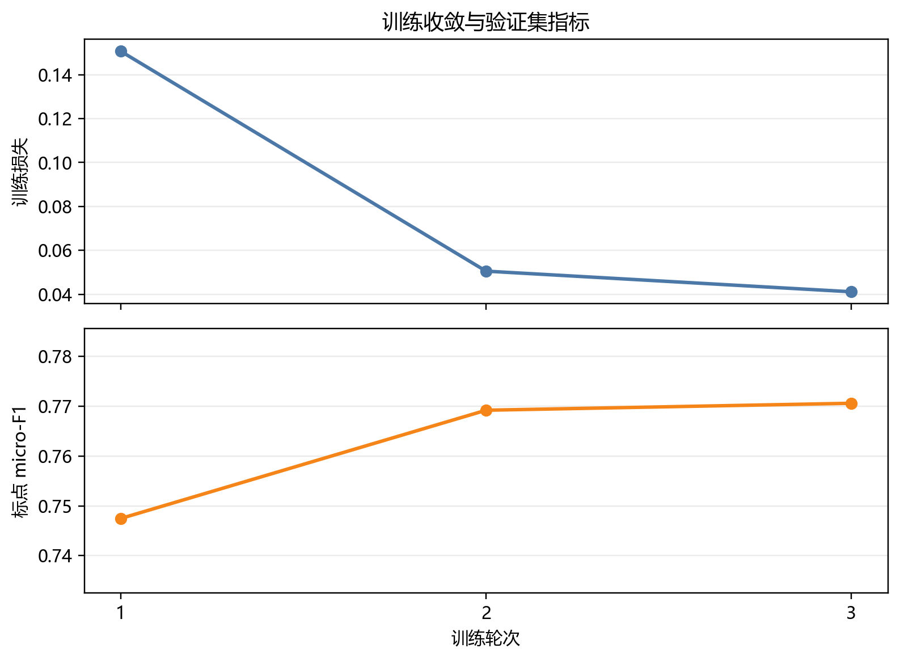
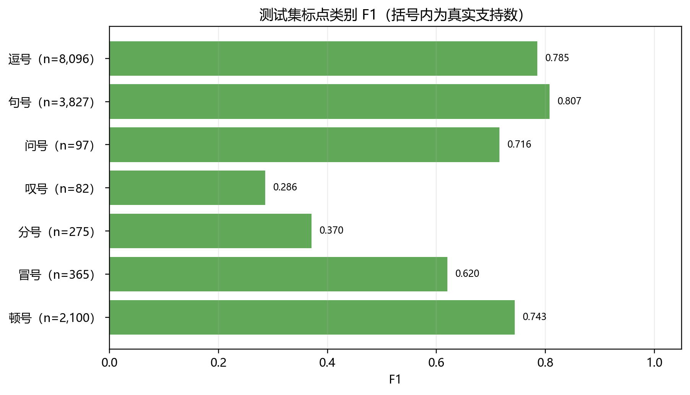
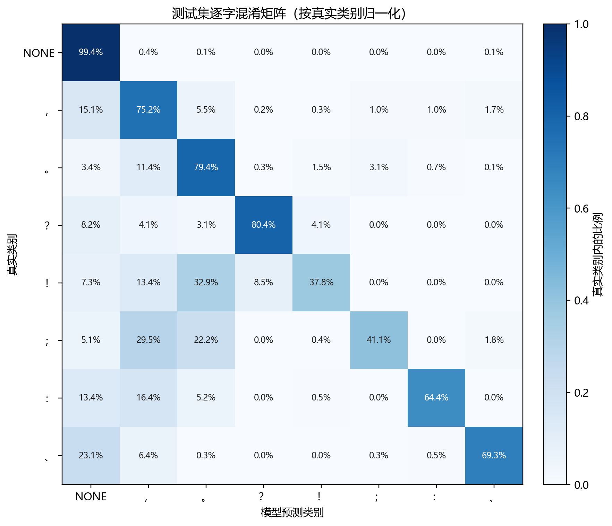
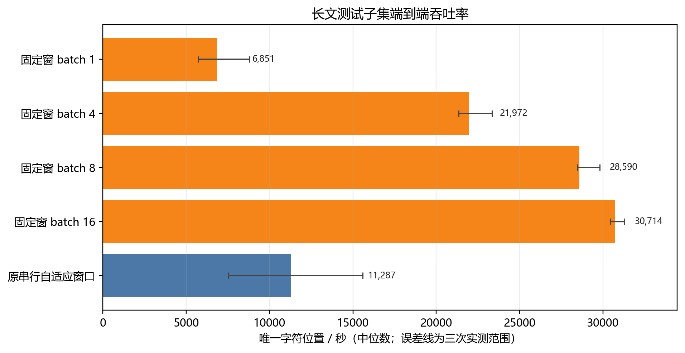

# BERT 中文标点恢复——基于人民日报微调与长文本批量滑窗推理

## 摘要

本文研究中文新闻标点恢复的类别差异，以及长文本滑窗推理的效率与质量取舍。实验从 1998 年 1 月《人民日报》构造 2,779 篇文章、1,574,260 个字符位置的数据，按文章划分训练、验证和测试集，在 bert-base-chinese 上微调包含七类标点与 NONE 的逐字符分类模型。279 篇文章的留出测试取得标点 micro-F1 0.76771、macro-F1 0.61823；类别混淆表明，低频标点及停顿边界是主要误差来源。长文推理采用验证集选择的 256 字窗口、128 字步长，对重叠区域融合类别概率。在 60 篇长文测试子集上，batch size 16 的固定窗口端到端吞吐为 30,714 字符位置/秒，是串行自适应窗口的 2.72 倍；两者标点 micro-F1 分别为 0.76705 和 0.76580。结果表明，批量重叠滑窗在保持接近的聚合预测质量时能够提高处理效率，而具体位置的标点选择仍随窗口策略变化。

## 1. 引言

标点恢复要根据没有标点的文本序列推断停顿、分句及语气边界。将每个字符视为一个位置并预测其后是否附加标点，可以将任务写成序列标注问题。双向 Transformer 预训练模型 BERT 能在各层联合利用左右文脉，并可通过任务分类头进行微调［1］。相关工作已将基于 BERT 的方法用于噪声语音转写文本，并研究利用外部文本数据改善域内标点恢复［2］。本文将这一建模思路用于中文新闻，重点考察类别不均衡和长文本分窗带来的影响。

本实验聚焦两个问题：在单一新闻来源的文章级留出集上，模型能否恢复七类常见中文标点，各类别之间表现有何差异；对于长文本，固定重叠窗口与批处理相对既有串行自适应窗口能够带来多少端到端吞吐提升，其预测结果又有多大变化。实验比较始终使用同一个微调模型，长文对照改变的是窗口策略与 batch size。

## 2. 数据与任务构造

原始材料为仓库中的 1998 年 1 月《人民日报》带音文本，以 GB18030 解码。清洗程序按文章及行号整理正文，去除标题行，并将正文记录连接为字符序列。移除注音标记后对字符进行 NFKC 规范化，再将兼容形式映射到七种目标标点。标点标签赋给其前一个保留字符，模型输出表示应在该字符之后插入的标点。数字两侧均为数字的小数点保留为输入字符，不视作目标标点。

每个位置只能有一个分类标签，因而连续目标标点会折叠为最后一个标点。引号、书名号、括号、破折号、省略号及其他非目标符号不作为模型标签，并从字符骨架中删除；因此当前模型不会重建这些符号。规范化后共有 2,779 篇文章和 1,574,260 个字符位置。数据按文章 ID 的固定哈希顺序、使用种子 20261015 作确定性划分，三个集合之间没有文章重叠。

**表 1　文章级数据划分及字符位置数。**

| 数据划分 | 文章数 | 字符位置数 |
|---|---:|---:|
| 训练集 | 2,223 | 1,249,095 |
| 验证集 | 277 | 154,425 |
| 测试集 | 279 | 170,740 |

训练集用于拟合模型参数，验证集用于选择训练轮次及长文窗口参数，测试集仅用于最终评估和长文策略比较。测试集的 NONE 标签占 91.31%，说明该任务具有显著的类别不均衡；因此，单独报告逐字准确率不能充分描述标点恢复效果。

## 3. 方法

### 3.1 逐字符分类器

模型采用 google-bert/bert-base-chinese，并在预训练编码器上添加八分类 token-classification 头，标签包括 NONE 和七类标点［3］。使用词表对 Unicode 字符逐字查表；缺少词条的字符映射为 [UNK]。全语料中 [UNK] 字符占 0.0957%。模型序列包含 [CLS] 和 [SEP]；训练与常规测试的最长序列为 256 token，因此每个非重叠窗口最多监督 254 个正文字符，每个原始字符在一个窗口内获得一次标签。

编码器和分类头联合微调。训练目标为加权交叉熵：NONE 权重为 1；七类标点的权重根据训练集频数按中位数与本类频数之比的平方根计算，再裁剪到 0.5 至 4.0。频数权重只由训练集估计，使低频类别在训练损失中获得较大权重。

### 3.2 长文本滑窗与概率融合

长文本固定窗口以字符位置规划；本实验将窗口候选限制在 (256, 128)、(400, 300)、(256, 256) 和 (400, 400)，其中前一数值为窗口字符数，后一数值为步长。窗口覆盖同一字符时，先对模型 softmax 概率取算术平均，再选概率最高的类别：

对字符位置 i 和类别 c，计算平均概率 pᵢ(c) = (1 / |Wᵢ|) Σ_{w∈Wᵢ} P(c | xᵢ, w)，并选择 ŷᵢ = arg max_c pᵢ(c)。其中 Wᵢ 是覆盖该位置的窗口集合，xᵢ 是该位置的输入字符。该做法融合不同窗口上下文下的预测分布，而不是对离散标签投票。根据验证集标点 micro-F1 选出 256 字窗口、128 字步长；测试数据不参与该选择。

速度比较中的固定窗口方法将预先规划的窗口按 batch size 1、4、8 或 16 送入模型。串行基线沿用自适应策略：每次输入最多 400 token（最多 398 个正文字符）；若剩余文本更长，则在前 300 个预测位置内提交到最后一个模型预测句号，若该范围内没有句号则提交 300 字；其余文字随后重新预测。窗口边界不使用金标。两种策略使用同一 checkpoint，因而比较反映推理分窗与批处理方式，不是模型结构之间的比较。

## 4. 实验设置

训练使用 AdamW，学习率 2×10⁻⁵、权重衰减 0.01、batch size 8、梯度累积 1、梯度范数裁剪 1.0，并采用 FP16 自动混合精度训练 3 轮。固定随机种子为 20261015。每轮后在验证集评估；以排除 NONE 的七类标点 micro-F1 选择 checkpoint。实验环境为 Python 3.12、PyTorch 2.12.0+cu126、Transformers 4.51.3 和 NVIDIA RTX 3060 Laptop GPU（6 GiB）。

整体测试指标中，标点 micro precision、recall 和 F1 将七类标点合并统计并排除 NONE；macro-F1 是七类 F1 的算术平均；句界 F1 只包含句号、问号和叹号。长文窗口参数只根据验证集上长度至少 800 字的 60 篇文章选择。测试长文比较使用测试集中同样长度条件的 60 篇文章，共 96,686 个唯一字符位置。计时前进行短预热，并将各固定窗口 batch size 与串行方法按不同顺序交错运行三次；报告端到端耗时中位数，图中误差线表示三次实测的最小值与最大值。端到端计时包括分窗、查表分词、数据传输、模型推理及窗口融合。模型加载不在计时范围内。

## 5. 实验结果

### 5.1 训练过程与 checkpoint 选择

训练损失随轮次下降，验证集标点 micro-F1 从第 1 轮的 0.74746 提高到第 3 轮的 0.77060，最佳 checkpoint 因而来自第 3 轮。主要提升发生在前两轮；第 2 至第 3 轮 micro-F1 仅增加 0.00140，显示按该指标观察时后期增益趋缓。训练损失与验证集指标见图 1。

**表 2　各轮训练损失与验证集主要指标。**

| 轮次 | 训练损失 | 验证标点 micro-F1 | 验证句界 F1 |
|---:|---:|---:|---:|
| 1 | 0.15069 | 0.74746 | 0.79441 |
| 2 | 0.05052 | 0.76921 | 0.79623 |
| 3 | 0.04112 | **0.77060** | **0.79836** |

**图 1　训练损失与验证集标点 micro-F1 随训练轮次的变化。** 两个指标分面展示；模型选择依据为验证集标点 micro-F1。

### 5.2 文章级留出测试

测试集包含 170,740 个字符位置。模型逐字准确率为 0.97196，较恒预测 NONE 的 0.91307 高 5.89 个百分点；但该差值仍受多数类主导。用于刻画目标任务的标点 micro-F1 为 0.76771，macro-F1 为 0.61823，二者相差约 0.149。标点 precision（0.79340）高于 recall（0.74363），表明测试集中仍有一部分真实标点没有被恢复。

**表 3　测试集整体分类指标。**

| 指标 | 测试结果 |
|---|---:|
| 逐字准确率 | 0.97196 |
| 恒预测 NONE 的准确率 | 0.91307 |
| NONE 召回率 | 0.99370 |
| 标点 micro precision / recall / F1 | 0.79340 / 0.74363 / **0.76771** |
| 七类标点 macro-F1 | 0.61823 |
| 句界 precision / recall / F1 | 0.79540 / 0.78607 / **0.79071** |

逐类结果显示，句号和逗号的 F1 分别为 0.80744 和 0.78486，顿号为 0.74348。问号仅有 97 个测试实例，F1 为 0.71560；分号和叹号的 F1 分别为 0.37049 和 0.28571，其中叹号支持数仅为 82。图 2 同时列出各类真实支持数，便于将 F1 与样本量共同解读。

**表 4　测试集七类标点的分类指标及真实支持数。**

| 标点类别 | 测试支持数 | Precision | Recall | F1 |
|---|---:|---:|---:|---:|
| 逗号（，） | 8,096 | 0.82119 | 0.75161 | 0.78486 |
| 句号（。） | 3,827 | 0.82096 | 0.79436 | 0.80744 |
| 问号（？） | 97 | 0.64463 | 0.80412 | 0.71560 |
| 叹号（！） | 82 | 0.22963 | 0.37805 | 0.28571 |
| 分号（；） | 275 | 0.33731 | 0.41091 | 0.37049 |
| 冒号（：） | 365 | 0.59796 | 0.64384 | 0.62005 |
| 顿号（、） | 2,100 | 0.80209 | 0.69286 | 0.74348 |

**图 2　测试集各标点类别 F1，括号内为真实支持数。** 叹号、分号等低频类别的 F1 较低，而类别支持数相差近两个数量级。

按真实类别归一化的混淆矩阵（图 3）显示，错误主要包括标点漏插以及逗号和句号之间的混淆。例如，8,096 个真实逗号中有 1,219 个被预测为 NONE；2,100 个真实顿号中有 486 个被预测为 NONE。类别之间的错分也较突出：448 个真实逗号被预测为句号，435 个真实句号被预测为逗号。分号中有 81 个被预测为逗号。测试错误样例中，模型曾在“比价计算”的“算”后多插逗号；在“洗劫一空，今天一个新村”中则将原逗号预测为句号。这些例子与混淆统计共同表明，错误不仅是是否插入标点，也涉及标点类别及句法边界的判断。

**图 3　测试集逐字混淆矩阵。** 行对应真实类别，列对应模型类别；每行按该真实类别的样本数归一化，颜色与标注表示行内比例。

### 5.3 长文窗口与端到端吞吐

验证集窗口选择结果列于表 5。256 字窗口、128 字步长的标点 micro-F1 最高，为 0.75518；相较其他配置，它同时产生更多窗口。该选择体现了本实验采用“先最大化验证 F1、同分时选窗口较少方案”的规则，并非吞吐率最优解。

**表 5　长文验证集窗口参数网格。**

| 窗口字符数 | 步长 | 验证长文数 | 验证字符位置数 | 窗口数 | 标点 micro-F1 | 标点 macro-F1 | 句界 F1 |
|---:|---:|---:|---:|---:|---:|---:|---:|
| **256** | **128** | 60 | 82,632 | 615 | **0.75518** | 0.61573 | 0.78664 |
| 400 | 300 | 60 | 82,632 | 283 | 0.75389 | 0.60655 | 0.78927 |
| 256 | 256 | 60 | 82,632 | 355 | 0.75014 | 0.61112 | 0.77693 |
| 400 | 400 | 60 | 82,632 | 241 | 0.74794 | 0.61476 | 0.77706 |

在独立的 60 篇长文测试子集上，固定窗口计划包含 723 个窗口；串行策略的三次运行窗口数中位数为 363。表 6 给出实际标点 F1 与端到端速度。固定窗口 batch 16 以 500 MiB 峰值已分配显存达到 30,714 字符位置/秒，端到端中位耗时为 3.148 秒；串行策略以 423 MiB 达到 11,287 字符位置/秒，中位耗时为 8.566 秒。固定 batch 16 的吞吐为串行方法的 2.72 倍。batch 4 至 batch 16 的三次计时波动较小，串行与 batch 1 的波动较大，故使用中位数并在图 4 展示实测范围。

**表 6　长文测试子集标点 F1 与端到端推理表现。**

| 推理策略 | Batch size | 长文标点 micro-F1 | 端到端中位耗时（秒；三次范围） | 吞吐（字符位置/秒） | 峰值已分配显存（MiB） |
|---|---:|---:|---:|---:|---:|
| 固定窗 256/128 | 1 | 0.76681 | 14.113（11.012–16.874） | 6,851 | 418 |
| 固定窗 256/128 | 4 | 0.76696 | 4.400（4.143–4.531） | 21,972 | 432 |
| 固定窗 256/128 | 8 | 0.76679 | 3.382（3.244–3.394） | 28,590 | 454 |
| 固定窗 256/128 | 16 | 0.76705 | **3.148（3.091–3.176）** | **30,714** | 500 |
| 串行自适应窗 | 1 | 0.76580 | 8.566（6.205–12.850） | 11,287 | 423 |

**图 4　长文测试子集端到端吞吐率。** 柱长表示三次运行吞吐中位数，误差线表示最小至最大实测值；所有方法处理相同的 96,686 个唯一字符位置。

固定窗 batch 16 相对串行策略的 F1 高 0.00124，但这不能说明两个策略逐字一致。保存的 batch 1 预测表明，固定窗与串行策略在 96,686 个位置中有 880 个位置不同，一致率为 99.09%。在这 880 处，固定窗口独自命中金标 400 处、串行策略独自命中 389 处、两者均未命中 91 处。较小的聚合 F1 差距掩盖了位置层面的不同，因此应把速度提升解释为策略间的工程权衡，而不是固定窗逐处优于串行策略。

## 6. 跨域定性案例

为观察模型在训练领域外的输出，使用维基文库《论语·学而第一》第一至第三章的一段文字作为定性案例［4］。输入长度为 89 个字符，去除目标标点及引号后送入同一 checkpoint；模型输出插入 16 个目标标点。表 7 对照来源文本中的停顿位置与模型输出。

**表 7　古文定性案例中的来源标点与模型预测。**

| 无标点输入片段 | 来源文本 | 模型输出 |
|---|---|---|
| 子曰学而时习之不亦说乎 | 子曰：“学而时习之，不亦说乎？” | 子曰：学而时习之，不亦说乎？ |
| 其为人也孝弟而好犯上者鲜矣不好犯上而好作乱者未之有也 | 其为人也孝弟，而好犯上者，鲜矣；不好犯上，而好作乱者，未之有也。 | 其为人也！孝弟而好犯上者鲜矣！不好犯上而好作乱者未之有也！ |
| 孝弟也者其为仁之本与 | 孝弟也者，其为仁之本与？ | 孝弟也者，其为仁之本？与？ |

模型在第一段恢复了主要停顿与问句标点，但在第二段多次输出叹号，且未能重建原有逗号与分号；第三段将问号提前，改变了问句内部的停顿位置。这个案例揭示了现代新闻模型在古文语气和分句结构上的迁移困难。引号属于当前标签集之外的符号，表中主要比较七类目标标点的位置和类型。

## 7. 讨论

测试结果支持两项相互关联的判断。首先，整体准确率会高估低频标点的恢复质量：测试位置中约九成属于 NONE，模型的 NONE 召回率达到 0.99370；标点 micro-F1 为 0.76771，macro-F1 却只有 0.61823。逗号、句号、顿号贡献大多数标点样本，因而对 micro 指标影响更大；低频叹号和分号的 F1 偏低，表明采用类别权重后仍存在明显的预测差异。固定文章划分和单次训练提供的是该条件下的点估计，低频类 F1 以及窗口间约 0.001 的差异应结合样本量作描述性解读。

其次，固定重叠窗口允许将不同位置的预测并行送入 GPU，因此 batch 增大时吞吐上升；在本机测试子集上，batch 16 将端到端吞吐提高至串行策略的 2.72 倍，代价是较高的批处理显存占用。固定窗和串行策略不仅执行顺序不同，其上下文窗口及提交边界也不同；固定窗对重叠区域融合概率，串行策略则依据预测句号推进。二者在 880 个字符位置给出不同标签，且两种策略各自独立命中金标的数目接近，说明聚合 F1 小幅提高并不等于无逐字代价。该基准来自单一 GPU、单一测试子集和三次运行，尤其串行及 batch 1 的运行时间波动较大，不能视作跨机器的吞吐保证。

相较能输出任意符号序列的生成式方法，字符级单标签保持了输入文字和输出位置的对齐，代价是只能在每个位置恢复一个目标标点。独立的最大概率解码也缺少对标点组合与配对的显式约束。相较全文编码，重叠窗口减少了单次处理长度，却只能通过局部预测融合传递信息，难以统一表达跨窗口的语篇关系。古文案例中的分号、逗号与叹号错误进一步显示，训练领域的句法和语气分布会限制迁移表现。

## 8. 结论

在 1998 年 1 月《人民日报》文章级留出测试集上，微调的中文 BERT 对七类目标标点取得 0.76771 的 micro-F1；0.61823 的 macro-F1 和类别混淆结果进一步表明，整体分数掩盖了低频类别的不足。验证集选择的 256/128 固定滑窗在长文子集上允许高效批处理；batch 16 的实测端到端吞吐约为串行自适应策略的 2.72 倍，而标点 micro-F1 接近。两种策略在逐字预测上并不相同，因此吞吐收益应结合输出差异和显存需求评估。结论仅适用于该新闻语料、当前标签集与本机基准条件。

## 参考文献

［1］Jacob Devlin, Ming-Wei Chang, Kenton Lee, and Kristina Toutanova. 2018. BERT: Pre-training of Deep Bidirectional Transformers for Language Understanding. arXiv:1810.04805. https://arxiv.org/abs/1810.04805

［2］Xue-Yong Fu, Cheng Chen, Md Tahmid Rahman Laskar, Shashi Bhushan, and Simon Corston-Oliver. 2021. Improving Punctuation Restoration for Speech Transcripts via External Data. Proceedings of the Seventh Workshop on Noisy User-generated Text (W-NUT 2021), 168–174. Association for Computational Linguistics. https://doi.org/10.18653/v1/2021.wnut-1.19

［3］Google. bert-base-chinese model card. Hugging Face. https://huggingface.co/google-bert/bert-base-chinese

［4］维基文库：《论语/学而第一》。https://zh.wikisource.org/zh-hans/%E8%AB%96%E8%AA%9E/%E5%AD%B8%E8%80%8C%E7%AC%AC%E4%B8%80

## 复现材料

环境依赖与运行命令见仓库 README。**本次实验的代码及相关说明可在该仓库中获取：**[LLMandAppliedPractices-BERT-Punctuation](https://github.com/stq1234/LLMandAppliedPractices-BERT-Punctuation)。
